 

## 🚂 Trailblaze log

I'm a vocational student studying software development (RPL) in **Malang, Indonesia**. I mostly build for the web, and lately I've been spending more time with **Flutter**. A lot of my projects start as PjBL assignments, and I tend to keep building after the assignment is done.

- **Now building:** [Shin Joy Spa](https://github.com/Tissk-2/Shin-Joy-Spa-Website) (backend) and [Grafidu](https://github.com/Tissk-2/Grafidu) (Next.js)
- **Leveling up:** Flutter and Dart
- **Off duty:** riding the rails in Honkai: Star Rail

## Equipped relics

| Slot | Gear | Buff |
|:---|:---|:---|
| **Head** |  | Backends, bookings, admin panels |
| **Hands** |  | Web frontends |
| **Body** |  | Making it look good |
| **Feet** |  | Mobile apps |
| **Planar sphere** |  | Data |
| **Link rope** |  | Shipping it |

## Light cones

| Project | What it does |
|:---|:---|
| [**Shin Joy Spa**](https://github.com/Tissk-2/Shin-Joy-Spa-Website)   | A spa booking site with live room availability, staff roles, an admin dashboard, and Telegram alerts for new bookings. English and Indonesian. |
| [**Grafidu**](https://github.com/Tissk-2/Grafidu)   | An education platform for XI RPL students and teachers that ties grades, materials, and assignments together, with AI recommendations for what to do next. |
| [**ALNU**](https://github.com/Tissk-2/ALNU-)   | A catalog of flora and fauna from across the Indonesian archipelago. It grew past the school assignment into an admin dashboard, comments, and user profiles with photo uploads. ([backend](https://github.com/Tissk-2/ALNU--Backend-)) |
| [**ARA Sinom**](https://github.com/Tissk-2/ara-sinom-website)   | A site for a healthy drink company in Malang, for retail orders and reseller partnerships, plus an [animated experiment](https://github.com/Tissk-2/Sinom-Ara-experiment-website) version. |
| [**SuaRasa**](https://github.com/Tissk-2/SuaRasa)  | A mobile app I'm building with Flutter. |
| [**GlitchCalc**](https://github.com/Tissk-2/GlitchCalc)   | A calculator with a glitch-inspired interface. |
| [**24 Possibilities**](https://github.com/Tissk-2/24-Possibilities)   | The 24 Game in the browser, built as a school portfolio project. |

## Combat record

  
   
  
  
   
  

## 🐍 Snack time

  

If something isn't here yet, there's a decent chance it's half-built somewhere on my machine.

